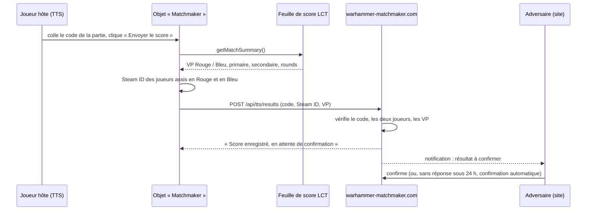

# V2 – Objet TTS qui envoie le score au site

Étude de faisabilité du 2026-10-27. **Verdict : faisable**, sans modifier le mod LCT, avec un objet que les joueurs ajoutent à leur table.

## Principe



Le site traite l'envoi exactement comme une déclaration faite à la main : **l'adversaire confirme** (ou conteste), et sans réponse sous 24 h le résultat est confirmé automatiquement. L'objet ne fait que supprimer la saisie manuelle des VP et les erreurs de recopie.

## Ce que LCT permet déjà

Analyse du dépôt de référence [Las0mbra/lct](https://github.com/Las0mbra/lct) (Tzabari/lct en est un fork) :

| Élément | Détail |
|---|---|
| Feuille de score | Objet de GUID `06d627`, exposé par `Global.getVar("scoreSheet_GUID")`. Inchangé depuis le début de l'historique public (mai 2026). |
| **`getMatchSummary()`** | Renvoie `{ red = { name, primary, secondary, painted, total, rounds }, blue = { … }, roundsPlayed }`. `total` est le score officiel (plafonné à 100, bonus de peinture inclus). |
| Stabilité | LCT appelle lui-même `getMatchSummary()` pour son tableau de score à l'écran : c'est une fonction utilisée, pas un détail interne oublié. Mais la feuille a été modifiée 18 fois entre mai et septembre 2026 : le mod évolue vite. |
| Couleurs | Rouge = joueur 1, Bleu = joueur 2 ; LCT lit les noms Steam des joueurs assis à ces couleurs. |

Ce que fournit TTS ([API officielle](https://api.tabletopsimulator.com)) :

- `obj.call("getMatchSummary")` pour interroger la feuille de score depuis un autre objet ;
- `Player.Red.steam_id` / `Player.Blue.steam_id` pour identifier les joueurs assis ;
- `WebRequest.custom(url, "POST", true, json, headers, callback)` pour envoyer du JSON. La requête part **de l'ordinateur de l'hôte** de la partie.

## Conception proposée

### Côté site

- **Un code de partie** de 8 caractères, généré au démarrage de chaque match, affiché **uniquement aux deux joueurs** sur l'écran de la partie (masqué aux spectateurs). C'est la seule preuve que l'envoi vient bien de cette partie.
- **`POST /api/tts/results`** (JSON) :
  ```json
  { "version": 1, "code": "K7Q2M9XA",
    "red":  { "steamId": "7656…", "vp": 85 },
    "blue": { "steamId": "7656…", "vp": 70 },
    "roundsPlayed": 5 }
  ```
  Le site vérifie, dans l'ordre : le code correspond à une partie **en cours** ; les deux Steam ID sont **exactement les deux joueurs** de la partie (dans n'importe quel ordre) ; les VP sont entre 0 et 100. Il enregistre alors une déclaration au nom de l'hôte (qui doit être l'un des deux joueurs) et prévient l'adversaire.
- **Protection** : limite du nombre d'appels par adresse IP, code inutilisable une fois le résultat déclaré, messages d'erreur sans détail exploitable.
- Pourquoi un code plutôt que retrouver la partie par les deux Steam ID : les Steam ID sont publics. Sans secret, n'importe qui pourrait déclarer un faux score, et la confirmation automatique au bout de 24 h le validerait si la victime ne réagit pas.

### Côté TTS : l'objet « Warhammer Matchmaker »

Une petite tuile posée sur la table, avec :

- un champ « Code de la partie » (pré-rempli à chaque partie par copier-coller depuis le site) ;
- un bouton **« Envoyer le score »** ;
- une ligne d'état : score lu (« Rouge 85 – Bleu 70 »), puis la réponse du site.

Le bouton est volontairement manuel (pas d'envoi automatique au clic « Game Over » de LCT) : on n'envoie que quand les deux joueurs sont d'accord que la partie est finie, et l'objet n'a pas à intercepter le fonctionnement de LCT.

Esquisse du script (Lua 5.2, compatible MoonSharp) :

```lua
local API = "https://warhammer-matchmaker.com/api/tts/results"
local code = ""

function onLoad()
    self.createInput({ input_function = "onCodeChanged", function_owner = self,
        label = "Code de la partie", width = 1600, height = 220, font_size = 140,
        position = {0, 0.2, -0.5}, validation = 1 })
    self.createButton({ click_function = "sendScore", function_owner = self,
        label = "Envoyer le score", width = 1600, height = 300, font_size = 150,
        position = {0, 0.2, 0.3} })
end

function onCodeChanged(_, _, value) code = value end

function sendScore(_, playerColor)
    local sheet = getObjectFromGUID(Global.getVar("scoreSheet_GUID") or "06d627")
    if not sheet then return broadcastToColor("Feuille de score LCT introuvable.", playerColor, "Red") end
    if not (Player.Red.seated and Player.Blue.seated) then
        return broadcastToColor("Les deux joueurs doivent être assis en Rouge et en Bleu.", playerColor, "Red")
    end

    local summary = sheet.call("getMatchSummary")
    local payload = JSON.encode({
        version = 1, code = code, roundsPlayed = summary.roundsPlayed,
        red  = { steamId = Player.Red.steam_id,  vp = summary.red.total },
        blue = { steamId = Player.Blue.steam_id, vp = summary.blue.total },
    })
    WebRequest.custom(API, "POST", true, payload, { ["Content-Type"] = "application/json" },
        function(request) broadcastToAll(request.is_error and "Envoi impossible : " .. request.error or request.text) end)
end
```

### Distribution aux joueurs

- **Fichier « Saved Object »** téléchargeable depuis le site, à copier dans `Documents/My Games/Tabletop Simulator/Saves/Saved Objects/`, puis *Objects → Saved Objects* dans TTS.
- **Steam Workshop** (plus simple pour les joueurs : s'abonner puis *Objects → Workshop*) : à publier depuis ton compte Steam. Procédure exacte à vérifier dans TTS.
- **À plus long terme** : proposer aux mainteneurs de LCT d'intégrer un bouton « Envoyer à Warhammer Matchmaker » directement dans le mod (aucun objet à ajouter, et l'interface de LCT devient un contrat qu'ils maintiennent).

## Risques

| Risque | Parade |
|---|---|
| LCT change `getMatchSummary` ou le GUID de la feuille (mod très actif). | Message clair dans TTS si la feuille est introuvable ; repli sur `playerSum(1/2)` ; champ `version` dans l'envoi ; prendre contact avec le mainteneur de LCT. Dans le pire cas, la saisie manuelle reste disponible. |
| Un joueur n'est pas assis en Rouge/Bleu (spectateur, autre couleur). | L'objet refuse d'envoyer et l'explique. |
| L'hôte n'est pas l'un des deux joueurs. | Le site refuse ; un des deux joueurs doit héberger (cas habituel). |
| Faux envoi. | Code secret par partie + vérification des deux Steam ID + confirmation par l'adversaire. |
| Le script ne peut pas être testé automatiquement dans TTS. | Logique du script testée hors de TTS avec Lua 5.4 et de faux objets TTS/LCT ; validation finale à la main dans TTS (par toi). |

## Découpage et effort

| Étape | Contenu | Effort |
|---|---|---|
| 1 | Code de partie (domaine + base), affiché aux seuls joueurs sur l'écran de la partie | ~2 h |
| 2 | API `POST /api/tts/results` en TDD (validation, déclaration, notification, limite d'appels) | ~3 h |
| 3 | Script de l'objet + tests de sa logique avec de faux TTS/LCT | ~3 h |
| 4 | Objet TTS (Saved Object), page d'aide « Envoyer le score depuis TTS » sur le site | ~1 h |
| 5 | Essai réel dans TTS avec une partie LCT (toi + un second joueur), puis publication Workshop | à faire ensemble |

## Décisions (27 octobre 2026)

1. **Code de partie collé dans l'objet**, gardé avec la sauvegarde de la table.
2. **Les deux envois** : LCT n'affiche plus de bouton « Game Over » (défini dans son code mais jamais créé), il n'y a donc pas de fin de partie à détecter. À la place :
   - **score en direct** : toutes les 30 s, si le score a changé, `POST /api/tts/live` ; la page de la partie l'affiche à tous, sans rien déclarer (gardé en mémoire seulement) ;
   - **bouton « Envoyer le score final »** : `POST /api/tts/results`, déclaration au nom de l'hôte.
3. **Confirmation par l'adversaire** maintenue, comme une saisie à la main.
4. Contact avec le mainteneur de LCT : plus tard.

## Mise en œuvre

| Élément | Où |
|---|---|
| Script de l'objet | `tts/WarhammerMatchmaker.lua`, tests avec de faux TTS/LCT dans `tts/tests/` (`lua tts/tests/WarhammerMatchmaker_test.lua`, lancé en CI avec Lua 5.2) |
| Fichier « Saved Object » | généré par le site à partir du script embarqué : `/tts/WarhammerMatchmaker.json` |
| Page d'installation | `/tts` |
| API | `src/Matchmaker.Web/Tts/` : réponses JSON `{ message }` ; 400 envoi invalide, 403 joueurs ou hôte étrangers à la partie, 404 code inconnu, 409 résultat déjà déclaré, 429 plus de `Tts:RequestsPerMinute` envois par minute et par adresse IP |
| Interrupteur | `Tts:Enabled` (activé) : affiche le code de partie aux joueurs |

Reste l'étape 5 : essai réel dans TTS, puis éventuellement publication sur le Workshop.
